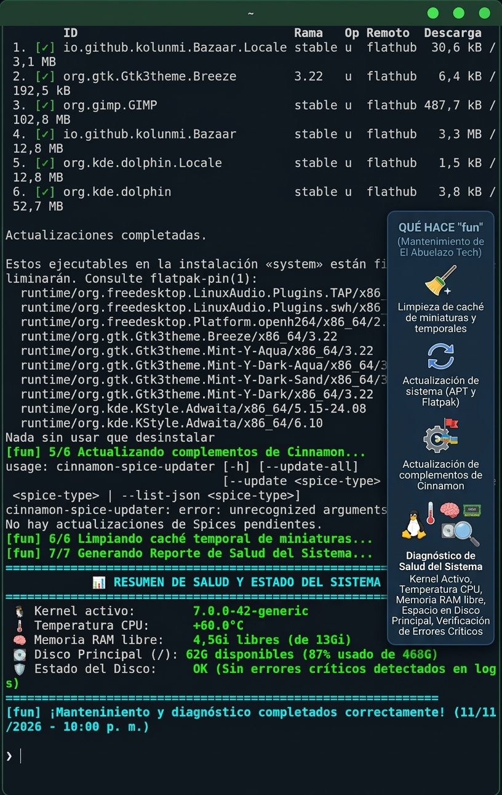

# FUN - Script de Mantenimiento y Salud para Linux Mint

Herramienta automatizada en Bash diseñada para facilitar el mantenimiento preventivo, la actualización de paquetes, la limpieza del sistema y la monitorización de salud en Linux Mint.

# El Abuelazo Tech - Fun (Script de Mantenimiento) Herramienta automatizada de limpieza, optimización y diagnóstico de salud del sistema para Linux Mint. Desarrollada por El Abuelazo Tech para agilizar el mantenimiento diario con un solo comando.

 

## 🚀 ¿Qué hace "fun"? Con solo escribir la palabra `fun` en tu terminal y presionar "intro", la herramienta ejecuta de forma secuencial las siguientes acciones: * 🧹 **Limpieza general:** Poda paquetes huérfanos y limpia la caché temporal de miniaturas del sistema. * 🔄 **Actualización de componentes:** Sincroniza repositorios, actualiza paquetes de sistema, paquetes Flatpak y complementos de Cinnamon de forma automatizada. * 🩺 **Diagnóstico de hardware y salud:** Al finalizar, genera un reporte visual en pantalla que detalla:  * Versión del Kernel activo.  * Temperatura actual de la CPU.  * Estado de la Memoria RAM libre y total.  * Espacio disponible y porcentaje de uso del Disco Principal (`/`).  * Verificación de errores críticos en los registros del sistema (`Estado del Disco`). ## 📥 Instalación Puedes descargar el paquete instalable precompilado **`fun_1.0-1_amd64.deb`** directamente desde este repositorio y ejecutarlo con un doble clic para una instalación rápida y limpia en tu sistema Linux Mint.

---

## ☕ ¿Te resulta útil este proyecto?

Si este script te ha servido para hacerte la vida más fácil con tu Linux Mint y quieres apoyar el desarrollo de más herramientas y contenido para **El Abuelazo Tech**, ¡estos proyectos se alimentan a base de buen café! 

Puedes invitarme a un café virtual por aquí:

👉 **[¡Invítame un café en Ko-fi!](https://ko-fi.com/abuelazotech)** 

¡Mil gracias por tu apoyo y por formar parte de esta comunidad!
